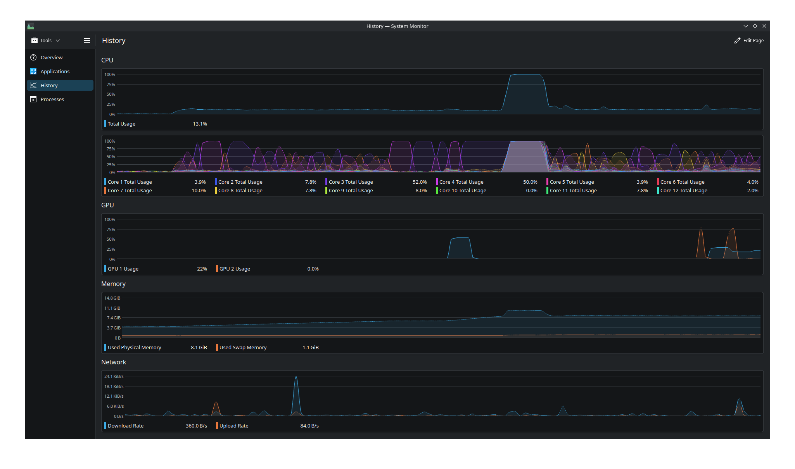
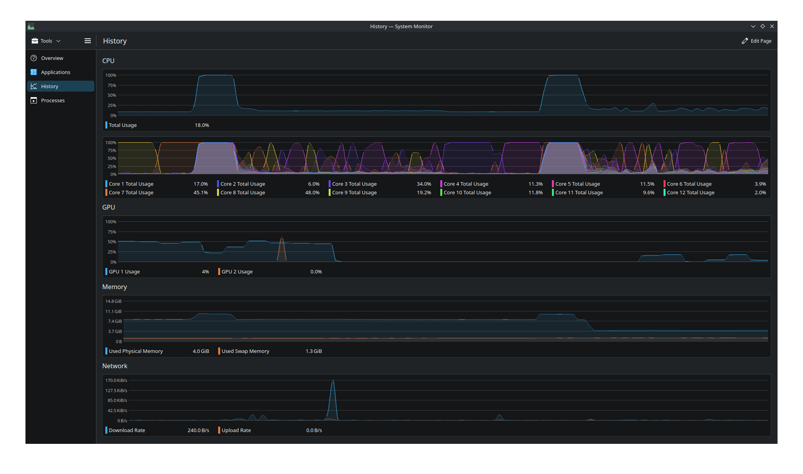
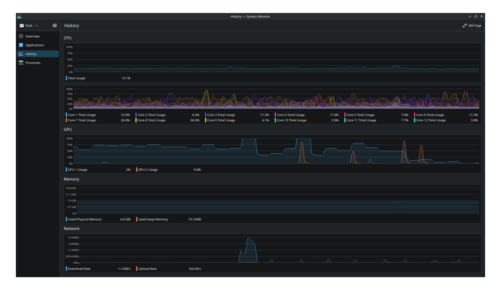

<table style="width: 100%; border-collapse: collapse; border: none;">
  <tr style="border: none;">
    <td style="width: 25%; text-align: center; vertical-align: middle; border: none; padding: 10px;">
      
    </td>
    <td style="width: 75%; vertical-align: middle; border: none; padding-left: 15px;">
      <h1 style="margin-top: 0;">Proyecto 1</h1>
      <p style="margin: 4px 0;"><strong>Centro de Investigación y de Estudios Avanzados del Instituto Politécnico Nacional</strong></p>
      <p style="margin: 4px 0;">Unidad Zacatenco - Departamento de Computación</p>
      <br>
      <p style="margin: 4px 0;"><strong>Tópicos selectos: Cómputo de alto desempeño I</strong><br>
      Dr. José Rodríguez García</p>
      <br>
      <p style="margin: 4px 0;">Francisco Javier Meléndez Ruiz<br>
      José Julián Sierra Álvarez<br>
      <em>Maestría en Ciencias en Computación</em></p>
    </td>
  </tr>
</table>

## 1. Introducción

En el marco de la materia de Tópicos Selectos: Cómputo de Alto Desempeño (HPC), este documento presenta el diseño, desarrollo y evaluación experimental del proyecto enfocado en el procesamiento y ordenamiento ascendente a gran escala de un archivo de datos masivo (*40,000 x 40,000* elementos, equivalente a *1,600,000,000* valores de tipo double y un tamaño en disco de aproximadamente 16.8 GB), este es el archivo proporcionado por el profesor. 
El desarrollo del trabajo fue llevado a cabo de manera colaborativa en conjunto por Francisco Javier Meléndez Ruiz y José Julián Sierra Álvarez, estableciendo como fecha límite de entrega el 20 de noviembre de 2026. Para cumplir con los requerimientos de la asignatura, el sistema fue implementado desde los cimientos mediante una filosofía de sistemas de bajo nivel, adoptando restricciones como la prohibición de utilizar bibliotecas externas para la gestión de archivos CSV (desarrollando un analizador léxico manual en streaming), y principalmente aprovechar el equipo usando las tecnicas aprendidas de programación multinúcleo, multiproceso y multihilo para maximizar el uso de los recursos de hardware disponibles. 
A lo largo de este reporte se detallarán las dificultades técnicas encontradas frente al volumen masivo de datos, los cambios de paradigma arquitectónico desde un procesamiento puramente en memoria hasta un esquema híbrido por segmentación.

---

## 2. Marco Teórico

Para fundamentar la arquitectura del sistema, se estudiaron e implementaron los siguientes conceptos y tecnologías clave en el cómputo de alto rendimiento:

### 2.1 Multithreading, Multicore y SMT

El paralelismo a nivel de hilo se implementó mediante la interfaz estándar POSIX threads (`pthreads`), permitiendo distribuir cargas de trabajo discretas entre múltiples hilos de ejecución. Para la sincronización eficiente en entornos concurrentes sin incurrir en cuellos de botella en las rutas críticas, se utilizaron primitivas de exclusión mutua configuradas con el atributo de compartición de procesos (`PTHREAD_PROCESS_SHARED`). A nivel de hardware, el diseño explota la arquitectura *Simultaneous Multi-Threading* (SMT) de los núcleos lógicos para solapar la latencia de acceso a la memoria principal durante las operaciones de reubicación de datos.

### 2.2 Memoria Mapeada (`mmap`) y Procesamiento por Chunks

Para evitar la saturación de la memoria RAM del sistema al interactuar con ficheros masivos, se emplearon llamadas al sistema Unix de mapeo de archivos en memoria (`mmap`, `shm_open`, `ftruncate`). Asimismo, se integraron directivas de optimización de paginación mediante `madvise` (`MADV_SEQUENTIAL` y `MADV_DONTNEED`), permitiendo liberar de manera síncrona las páginas físicas ya procesadas y garantizando que el consumo de memoria residente (*Resident Set Size*, RSS) permanezca acotado a unos cuantos megabytes durante la lectura en streaming.

### 2.3 Algoritmos de Ordenamiento y Evolución de Paradigmas

* **Aplicamos un Merge Sort Propio** Algoritmo base de ordenamiento interno basado en la estrategia *divide y vencerás* (top-down), de complejidad temporal determinista $\mathcal{O}(N \log N)$ y estabilidad garantizada. Se clasifica como un algoritmo out-of-place (fuera de lugar), ya que requiere un arreglo auxiliar de memoria temporal del mismo tamaño que el segmento a ordenar para realizar la mezcla de las mitades de manera eficiente.
* **Decisión de Métodos Algorítmicos** En las fases iniciales de diseño se ponderó el uso del algoritmo *Bucket Sort* tradicional con rangos fijos. Sin embargo, ante la necesidad de paralelizar el ordenamiento de grandes volúmenes de datos y despues de nuestra investigación principal nos reveló que ante datos sesgados, o distribuciones no uniformes, las cubetas habrían sufrido un desbalance de carga (inanición en unos hilos y saturación en otros). Por esta razón, se evolucionó la arquitectura hacia *Sample Sort* obtenido de la literatura: mel cual utiliza un muestreo aleatorio (*reservoir sampling*) para calcular dinámicamente puntos de corte (splitters) equidistantes. Esto garantiza matemáticamente un balanceo de carga óptimo. Operativamente, combina fases out-of-place durante la dispersión o scatter hacia un buffer temporal, con ordenamientos locales que pueden optimizarse en el uso de memoria.
* **Finalmente Nosotros Implementamos el External Merge Sort con K-Way Merge** Ante problemas de hardware al alojar estructuras masivas de *25.6 GB* en equipos con menos de esa cantidad de memoria RAM y Swap, incorporamos un sistema de ordenamiento externo de dos fases, la generación de bloques ordenados o runs en paralelo mediante Sample Sort, y su unificación posterior en streaming utilizando una estructura de datos de Min-Heap (Tournament Tree). Esta aproximación reduce drásticamente el espacio auxiliar requerido en memoria principal a solo unos cuantos megabytes dedicados a búferes de lectura.

### 2.4 Acceso a Memoria, Parte Secuencial Contra Parte Paralela

El rendimiento de los sistemas de alto rendimiento está condicionado por el ancho de banda del bus de memoria y las restricciones físicas del almacenamiento secundario. Todo sistema paralelo posee componentes intrínsecamente secuenciales (como el análisis léxico inicial de lectura de ficheros o la escritura final de resultados) y componentes altamente paralelizables (como el ordenamiento local de bloques). El análisis formal del impacto de estas fracciones sobre el rendimiento global se aborda mediante modelos matemáticos de aceleración en la sección de metodología. **a que se refiere con analisis formal?**

---

## 3. Metodología y Decisiones de Diseño

### 3.1 Transición de Bucket Sort a Sample Sort

En las sesiones iniciales de planeación colaborativa del equipo, se evaluó preliminarmente el uso del algoritmo *Bucket Sort* tradicional con rangos fijos de cubetas para repartir los datos. Sin embargo, identificamos un posible riesgo antes de recibir la matriz característica (`matriz_a.txt`): ante conjuntos de datos sesgados o distribuciones no uniformes, las cubetas habrían sufrido un desbalance severo de carga, dejando a algunos hilos con millones de elementos y a otros completamente ociosos, inhabilitando el paralelismo efectivo.

Para evitar esta vulnerabilidad teórica, tomamos la decisión de cambiar hacia el paradigma de **Sample Sort**. Este enfoque aplica un muestreo aleatorio sin reemplazo, conocido como *reservoir sampling*, sobre un subconjunto de tamaño fijo de los datos. Posteriormente, ordena dicha muestra mediante nuestro Merge Sort interno y calcula dinámicamente $k$ puntos de corte o *splitters* equidistantes. Esto garantiza matemáticamente un balanceo de carga uniforme entre los hilos trabajadores, independientemente de la distribución subyacente de los valores numéricos.

### 3.2 Arquitectura de Memoria Compartida e Interprocesos (POSIX IPC)

Para cumplir con la restricción de procesar un volumen masivo de datos sin duplicar los 12.8 GB en el espacio de memoria dinámico (*heap*) local de múltiples procesos, se diseñó una capa de abstracción basada en llamadas nativas del sistema operativo Unix, y esto se logró al implementar diversas herramientas, como la creación del segmento global, para el cual se utilizo `shm_open` en conjunto con `ftruncate` para reservar un objeto de memoria compartida con los permisos y dimensiones requeridas en el directorio temporal del kernel; despues de esto se nos ocurrio realizar el mapeo de memoria cero copias mediante `mmap`, tanto el proceso maestro como los hilos concurrentes proyectan el mismo bloque físico en sus respectivos espacios virtuales de direcciones, eliminando la sobrecarga de transferencia por tuberías o canales de copia, logrando una transferencia IPC eficiente. y tambien se implementaron primitivas de tipo `pthread_mutex_t` para una sincronizacion de exclusión mutua, inicializadas con el atributo de compartición entre procesos (`PTHREAD_PROCESS_SHARED`), lo que nos permitio lograr el objetivo de coordinar de manera segura el avance de los hilos sin generar contención excesiva en la ruta crítica.

### 3.3 Restricciones Físicas y Activación del Paradigma *Out-of-Core*

La lectura del archivo de entrada es inherentemente secuencial (un solo hilo de ejecución). La clase `ChunkedTextReader` mapea el archivo mediante `mmap` con la directiva `MADV_SEQUENTIAL` para activar la lectura anticipada del kernel y libera las páginas procesadas mediante `MADV_DONTNEED`. No obstante, el análisis léxico carácter a carácter no se paraleliza debido a que el ancho de banda de entrada/salida (I/O) del almacenamiento constituye el cuello de botella real del sistema, y no la velocidad de cómputo del procesador. El paralelismo se aplica exclusivamente a las fases de ordenamiento (dispersión/recolección y ordenamiento local de cubetas con `pthreads`).

#### Demostración Formal de Complejidad Espacial

Sea $N = 1.6 \times 10^9$ el total de elementos en `matriz_a.txt` y $S_{\text{double}} = 8\text{ bytes}$ el tamaño en memoria de cada número de punto flotante de doble precisión (IEEE 754). El espacio neto requerido para alojar un solo arreglo lineal de datos es:

$$M_{\text{base}} = N \times S_{\text{double}} = (1.6 \times 10^9) \times 8\text{ bytes} = 12.8 \times 10^9\text{ bytes} \approx 11.92\text{ GiB}$$


Un esquema puramente en memoria (*in-memory*) de Sample Sort requiere mantener simultáneamente en el sistema el arreglo original de entrada (`data`), el arreglo temporal de dispersión (`temp`) y los búferes auxiliares para el Merge Sort local de cada hilo ($\mathcal{O}(N/P)$):

$$M_{\text{in-memory}} = 2(N \times S_{\text{double}}) + \mathcal{O}\left(\frac{N}{P}\right) \approx 25.6\text{ GB} + 1.6\text{ GB} \approx 27.2\text{ GB}$$


Dado que este requerimiento excede tanto la memoria RAM física disponible como la cuota asignada a `/dev/shm` en nuestro entorno de ejecución (cuyas especificaciones detalladas se describen en la Sección 4.1), y descartando el uso de memoria virtual (*swap*) en disco por provocar degradación catastrófica debido al *page fault thrashing*, se implementó un sistema de **activación automática Out-of-Core (External Merge Sort)** en dos fases:

1. **Fase 1 (Generación de *Runs* Paralelos):** Se define un ***run*** como un bloque contiguo de datos de tamaño $M$ ($M \ll N$) que cabe íntegramente en la memoria compartida, es ordenado de forma independiente en paralelo y volcado a disco en formato binario compacto. El archivo `matriz_a.txt` se lee en *streaming* por bloques de tamaño $M$, se ordenan en paralelo mediante Sample Sort multihilo y se escriben temporalmente en el directorio `runs/run_XXXX.bin` (archivos que son eliminados automáticamente al finalizar la ejecución). La complejidad espacial en esta fase queda acotada a $\mathcal{O}(M) \approx 1.5\text{ GiB}$.


2. **Fase 2 (K-Way Merge en Streaming):** Los $K = \lceil N/M \rceil$ *runs* ordenados en disco se unifican concurrentemente utilizando una estructura de datos de cola de prioridad mínima (*Min-Heap* o *Tournament Tree*). Al mantener únicamente un búfer de lectura por cada *run* ($B = 1\text{ MB}$), el consumo de memoria RAM en esta etapa se mantiene estrictamente acotado a $\mathcal{O}(K \cdot B) < 50\text{ MB}$, emitiendo el flujo globalmente ordenado hacia el archivo destino.


### 3.4 Modelado Analítico y Ley de Amdahl

Para justificar formalmente las métricas de rendimiento y los límites de escalabilidad del sistema, el tiempo total de ejecución se modeló mediante la **Ley de Amdahl**.

#### Derivación de las Fracciones Secuencial ($s$) y Paralela ($p$)

A partir de las mediciones empíricas de tiempo de pared (*wall-clock time*) sobre la ejecución completa de `matriz_a.txt` con $K = 12$ *runs* y $12$ hilos lógicos, se aislaron los tiempos de cada etapa del *pipeline*:

* **Componentes secuenciales:** El análisis léxico y lectura de entrada desde disco ($T_{\text{lectura}} \approx 120.72\text{ s}$) sumado a la mezcla final y escritura secuencial del *K-Way Merge* ($T_{\text{merge}} \approx 23.99\text{ s}$) totalizan un tiempo secuencial fijo de $T_{\text{sec}} \approx 144.71\text{ s}$.


* **Componente paralelizable:** El ordenamiento en memoria de los $12$ *runs* mediante Sample Sort consumió $T_{\text{sort}}(12) \approx 81.53\text{ s}$. Considerando el factor de aceleración interno medido para el ordenamiento local de cubetas ($\approx 5.8\times$ respecto a la ejecución monohilo), el tiempo equivalente de ordenamiento secuencial puro se estima en $T_{\text{sort}}(1) \approx 81.53 \times 5.8 = 472.87\text{ s}$.


De este modo, el tiempo base de referencia monohilo es $T_{\text{total}}(1) = 144.71 + 472.87 = 617.58\text{ s}$, permitiendo obtener las proporciones exactas del sistema:

$$p = \frac{T_{\text{sort}}(1)}{T_{\text{total}}(1)} = \frac{472.87}{617.58} \approx 0.7657 \quad (76.57\%)$$


$$s = 1 - p = 1 - 0.7657 = 0.2343 \quad (23.43\%)$$


#### Cálculo de Aceleración y Cota Asintótica Máxima

La expresión general de la Ley de Amdahl establece que la aceleración (*speedup*) $S(N)$ al emplear $N$ unidades de procesamiento está dada por:

$$S(N) = \frac{1}{(1 - p) + \frac{p}{N}}$$


Evaluando el modelo para los $N = 12$ hilos lógicos de nuestro equipo de referencia:

$$S(12) = \frac{1}{(1 - 0.7657) + \frac{0.7657}{12}} = \frac{1}{0.2343 + 0.0638} = \frac{1}{0.2981} \approx 3.35\times$$


Para determinar el límite teórico máximo de aceleración ($S_{\max}$) que podría alcanzar esta arquitectura si dispusiera de infinitos núcleos de procesamiento ($N \to \infty$), se evalúa el límite asintótico de la ecuación:

$$S_{\max} = \lim_{N \to \infty} \frac{1}{(1 - p) + \frac{p}{N}} = \frac{1}{1 - p} = \frac{1}{0.2343} \approx 4.27\times$$


Este resultado demuestra analíticamente que la aceleración global del sistema está acotada asintóticamente a $4.27\times$, debido al peso ineludible del $23.43\%$ del tiempo gobernado por las operaciones de entrada/salida secuenciales.

### 3.5 Determinación Analítica y Empírica de Parámetros ($M^*$ y $P^*$)

Para fundamentar la configuración operativa del programa —en estrecha relación con la arquitectura de hardware y el sistema operativo descritos en la Sección 4.1—, los parámetros críticos se determinaron combinando análisis de complejidad y validación heurística con diversos tamaños de bloque ($64\text{ MB}$, $256\text{ MB}$, $512\text{ MB}$, $1024\text{ MB}$ y $2048\text{ MB}$):

* **Tamaño óptimo de chunks ($M^* \in [512\text{ MB}, 1024\text{ MB}]$):** El costo computacional de la fase de mezcla en un *K-Way Merge* es $\mathcal{O}(N \log_2 K)$, donde $K = \lceil N/M \rceil$ es el número de *runs* generados. Las pruebas empíricas demostraron que bloques muy pequeños (como $64\text{ MB}$) generan $191$ *runs*, incrementando la profundidad del *Min-Heap* y fragmentando las lecturas secuenciales en disco. Por el contrario, establecer $M = 1024\text{ MB}$ reduce el problema a solo $K = 12$ *runs* (profundidad de árbol $\lceil \log_2 12 \rceil = 4$), maximizando el aprovechamiento de la lectura anticipada (*read-ahead*) del kernel de Linux sobre el almacenamiento NVMe sin comprometer el límite físico de $7.5\text{ GiB}$ en `/dev/shm`.


* **Número de hilos óptimo ($P^* = 12$):** A partir de los barridos experimentales de escalabilidad (con $1, 2, 4, 8$ y $12$ hilos) y la topología del procesador utilizado en la Sección 4.1, se fijó $P^* = 12$ para aprovechar la totalidad de los hilos lógicos (SMT). Esto permite solapar las latencias de fallos de caché durante el *scatter/gather* y saturar eficientemente el ancho de banda de la memoria principal sin provocar penalizaciones por cambios de contexto (*context switching*) excesivos en el planificador del sistema operativo.


---

## 4. Desarrollo e Implementación

### 4.1 Entorno de Ejecución y Especificaciones de Hardware/Software

Todas las pruebas de rendimiento, análisis de consumo de memoria y validaciones de escalabilidad se ejecutaron bajo las siguientes especificaciones técnicas:

* **Procesador (CPU):** AMD Ryzen 5 6600H with Radeon Graphics (6 núcleos físicos, 12 hilos lógicos SMT).
* **Memoria Principal (RAM):** 14.85 GiB instalados (~10.6–10.7 GiB disponibles para espacio de usuario).
* **Memoria Compartida POSIX (`/dev/shm`):** 7.5 GiB montados sobre sistema de archivos temporal en memoria (`tmpfs`).
* **Almacenamiento Secundario:** Unidad de estado sólido NVMe (`/dev/nvme0n1p3`).
* **Sistema Operativo y Entorno:** Fedora Linux 45 (KDE Plasma Desktop Edition) x86_64
* **Compilador y Banderas:** `g++ (GCC) 15.2.0`, estándar C++17, compilado con optimización `-O3 -Wall -Wextra -std=c++17` y enlazado contra las bibliotecas del sistema `-lrt -lpthread`.

### 4.2 Arquitectura Modular del Sistema

Para mantener una estructura ordenada entre los componentes, distinguir responsabilidades de manera clara y facilitar la depuración aislada de fallos (*debugging*), el código fuente se organizó en módulos desacoplados con interfaces bien definidas:

* **`chunked_reader.hpp / .cpp`:** Implementa la clase `ChunkedTextReader`, cuya función principal `next()` lee y procesa bloques acotados del archivo de entrada directamente desde el espacio de memoria mapeado (`mmap` con la directiva `MADV_SEQUENTIAL` para activar la lectura anticipada del sistema operativo). Tras avanzar el cursor sobre tokens numéricos completos —evitando cortes accidentales de cifras entre fronteras de página—, invoca `madvise` con `MADV_DONTNEED` sobre las páginas ya consumidas. Esto libera la memoria física de forma inmediata y garantiza un consumo de memoria residente (RSS) acotado a ~152 MB independientemente del tamaño del fichero.


* **`csv_parser.hpp / .cpp`:** Contiene el analizador léxico manual carácter a carácter articulado en las rutinas `parse_csv_buffer()` y `parse_csv_into()`, así como su envoltorio de alto nivel `load_csv_into()`. Estas funciones recorren el flujo de bytes identificando delimitadores (espacios, comas, tabuladores y saltos de línea) y transformando las cadenas ASCII a punto flotante de doble precisión directamente sobre los arreglos destino en memoria compartida, prescindiendo por completo de bibliotecas externas o copias intermedias en el *heap*.


* **`shared_memory.hpp / .cpp`:** Gestiona el ciclo de vida completo de los segmentos de memoria compartida POSIX (`/proyecto1_hpc_data`, `/proyecto1_hpc_temp` y `/proyecto1_hpc_ctrl`) mediante las funciones `shared_create()` (que encadena `shm_unlink`, `shm_open`, `ftruncate` y `mmap`) y `shared_release()` (que ejecuta `munmap`, `close` y el desligado final). Adicionalmente, encapsula la inicialización (`shared_control_init()`) y actualización atómica (`shared_control_mark_done()`) de la estructura `SharedControl`, protegiendo los contadores de avance de los trabajadores mediante un mutex configurado con el atributo `PTHREAD_PROCESS_SHARED`.


* **`sample_sort.hpp / .cpp`:** Implementa la lógica estadística y de particionamiento del algoritmo Sample Sort. Incluye el generador pseudoaleatorio determinista `XorShift64` (sin depender de `<random>`), la rutina `random_sample()` que ejecuta un muestreo sin reemplazo (*reservoir sampling*) en una sola pasada $\mathcal{O}(n)$, `choose_splitters()` para extraer los puntos de corte equidistantes tras ordenar la muestra, y `find_bucket()`, una búsqueda binaria manual equivalente a `upper_bound` que asigna cada valor a su cubeta correspondiente asegurando que los elementos duplicados se dirijan consistentemente hacia la cubeta izquierda.


* **`scatter_gather.hpp / .cpp`:** Coordina la distribución global de los datos a través de la función principal `sample_sort_parallel()` y registra las métricas de telemetría por etapa en la estructura `ScatterGatherStats`. Su flujo interno ejecuta el plan de muestreo (`build_sample_plan()`), realiza el conteo de frecuencia por cubeta, calcula los desplazamientos iniciales (*offsets*) mediante suma de prefijos, dispersa los elementos (*scatter*) hacia el segmento temporal compartido y delega el ordenamiento concurrente, logrando una recolección (*gather*) implícita al quedar las cubetas contiguas y ordenadas.


* **`merge_sort.hpp / .cpp` y `parallel_sort.hpp / .cpp`:** Proveen el motor de ordenamiento interno y la ejecución concurrente. El primer módulo implementa `merge_sort()` y `merge_sort_range()` (un Merge Sort *top-down* estable con gestión de búfer temporal acotado al rango). Por su parte, `parallel_sort_buckets()` administra el ciclo de vida de los hilos POSIX (`pthread_create` y `pthread_join`), asignando las cubetas de tamaño variable de forma intercalada (*round-robin*) entre los trabajadores para equilibrar la carga sin sincronización fina.


* **`file_io.hpp / .cpp`:** Administra la serialización de salidas en formatos `.txt`, `.csv` y binario crudo `.bin` mediante `save_matrix()`. Para los ficheros binarios, escribe una cabecera estructurada (`MATBIN1` con metadatos de versión, tipo de dato, filas, columnas y conteo total) seguida de los valores `double` en formato *little-endian*. Asimismo, incorpora `verify_bin()`, una rutina que recorre archivos binarios masivos por bloques para auditar su integridad estructural y ordenamiento sin saturar la memoria.


* **`main.cpp`:** Actúa como el orquestador central del sistema. Procesa los argumentos de la línea de comandos, inspecciona en tiempo de ejecución la memoria RAM libre en `/proc/meminfo` y la capacidad de `/dev/shm` mediante `statvfs` para activar automáticamente el modo *Out-of-Core* cuando la matriz excede los recursos físicos, y ejecuta tanto la generación paralela de *runs* como el *K-Way Merge* final en *streaming*.


### 4.3 Mecanismos de Verificación e Integridad de Datos

Al procesar y reordenar $1,600,000,000$ de números de punto flotante de doble precisión sin el respaldo de bibliotecas externas, existe el riesgo de enfrentar corrupciones silenciosas, desbordamientos de índice o pérdidas de precisión durante las transferencias entre memoria y disco. Para blindar la exactitud matemática del resultado, se implementaron tres capas rigurosas de validación automática en tiempo de ejecución. En primer lugar, se aplica una verificación de monotonía estricta tanto al concluir cada ordenamiento local en memoria (mediante la función `is_sorted_ascending()`) como durante la emisión continua en *streaming* del *K-Way Merge*; en cada paso se evalúa la invariante $x_i \le x_{i+1}$, garantizando que el flujo final sea globalmente ascendente sin excepción.

Dado que la suma aritmética tradicional de números de punto flotante es no asociativa y sufre errores de redondeo según el orden en que se sumen los términos, validar la conservación de los elementos mediante sumas convencionales habría producido falsos negativos. Para resolverlo, se diseñó un verificador basado en un *checksum* de bits invariante al orden: el programa reinterpreta la representación binaria cruda de 64 bits de cada `double` como un entero sin signo (`uint64_t`) y acumula su suma entera tanto durante el análisis léxico inicial como al emitir el resultado ordenado. Al tratarse de aritmética entera modular, el resultado es matemáticamente idéntico sin importar la permutación de los datos, pero cambia drásticamente si un solo bit se altera, se duplica o se pierde; en todas las corridas sobre `matriz_a.txt`, el *checksum* de entrada y salida coincidió exactamente en `3238413133220595576`.

Finalmente, para asegurar la estabilidad operativa del sistema a nivel de gestión de memoria y recursos del sistema operativo, el código completo fue auditado dinámicamente utilizando las herramientas *AddressSanitizer* (`ASan`) y *UndefinedBehaviorSanitizer* (`UBSan`) bajo escenarios límite —tales como cubetas vacías, arreglos con alta densidad de valores duplicados y matrices de dimensiones mínimas—, descartando fugas de memoria (*memory leaks*), accesos fuera de límites (*buffer overflows*) o comportamiento indefinido. De igual manera, se verificó que todas las rutas de ejecución (incluidas las salidas por error) invoquen la liberación explícita de los descriptores de memoria compartida en `/dev/shm` y eliminen los archivos temporales del directorio `runs/`, dejando el entorno del sistema completamente limpio al finalizar.


### 4.4 Ejecuciones del Programa y Evidencias (Capturas de Pantalla)

A continuación se documentan las salidas reales de consola más optimas obtenidas durante las pruebas completas sobre `matriz_a.txt` ($40,000 \times 40,000$) utilizando $12$ hilos y tamaños de *run* de $1024\text{ MB}$ y $2048\text{ MB}$:

```text
$ ./ordenar_matriz 1024 --hilos 12 salida.bin

TEST: La matriz (1600000000 valores = 11.92 GB) no cabe en memoria
disponible (requiere 23.84 GB en shm / 35.76 GB en RAM;
disponible: 7.39 GB en shm / 10.72 GB en RAM).
-> Activando el Ordenamiento Externo Out-of-Core
   (runs en disco + K-Way Merge con Min-Heap y streaming)

--- FASE 1: Generacion y ordenamiento de runs en paralelo ---
Archivo de entrada : matriz_a.txt
Dimensiones        : 40000 x 40000 (1600000000 valores)
Tamano de run      : 1024.00 MB (134217728 valores)
Hilos por run      : 12 (Sample Sort con memoria compartida)
...
Fase 1 completada : 12 runs generados en 195237.30 ms
Estadistica runs  : Promedio 6419.38 ms +/- 218.43 ms (min 5931.03 ms, max 6987.72 ms)

--- FASE 2: K-Way Merge en streaming con Min-Heap ---
Runs a mezclar     : 12
Buffer por run     : 1.00 MB
Destino de salida  : salida.bin
...
--- Resumen Final del Ordenamiento Externo ---
Valores ordenados  : 1600000000 / 1600000000
Min / Max          : -10 / 10
Verificacion orden : ordenado en orden ascendente
Checksum de bits   : 3238413133220595576 vs 3238413133220595576 -> OK (mismos elementos)
Tiempo Fase 1      : 195237.300 ms (I/O entrada + runs paralelos)
Tiempo Fase 2      : 29645.153 ms (K-Way Merge streaming)
Tiempo Total Pared : 224882.812 ms
Archivo guardado   : salida.bin

```


#### Evidencia Visual


*Imagen 1. El inicio del proceso al ejecutarse con 2048 MB de tamaño de chunk y a 12 hilos, la lectura es secuencial pero el ordenamiento de cada chunk es paralelo.*


*Imagen 2. Fin de la fase 1 e inicio de la fase 2.*


*Imagen 3. Fin de la fase 2, como se puede observar, el tiempo de ejecución de esta fase es la más rápida.*


*Imagen 4. Mismo proceso en la fase 1, ejecutándose en chunks de 1024 MB.*


*Imagen 5. Captura de la terminal al ejecutar el ordenamiento y con el comando de validación del ordenamiento.*

---

## 5. Conclusiones y Análisis de Resultados

### 5.1 Hallazgos Principales y Desempeño Empírico

La ejecución experimental sobre la matriz `matriz_a.txt` ($40,000 \times 40,000 = 1.6 \times 10^9$ valores de tipo `double`) permitió validar la eficiencia del diseño híbrido *Out-of-Core* frente a distintas configuraciones de tamaño de bloque ($M$) y grado de paralelismo ($P$):

Tabla 1. Resultados generados por las ejecuciones de ambos 1024 MB y 2048 MB de tamaño de chunk con 12 hilos, el tiempo optimo fue el de 2048 MB. 
| Configuración ($M$ / Hilos) | *Runs* Generados ($K$) | Tiempo Fase 1 (Lectura + Sort) | Tiempo Fase 2 (*K-Way Merge*) | Tiempo Total de Pared | Throughput *K-Way Merge* |
| --- | --- | --- | --- | --- | --- |
| **1024 MB / 12 hilos**| 12| 195.24 s| 29.65 s| **224.88 s (~3.75 min)**| 53.97 M val/s|
| **2048 MB / 12 hilos**| 6 | 199.50 s| 27.90 s| **227.40 s (~3.79 min)**| 57.35 M val/s|

De las mediciones experimentales obtenidas se desprenden tres hallazgos fundamentales que validan el diseño arquitectónico del sistema. En primer lugar, respecto a la estabilidad y el balanceo de carga en *Sample Sort*, la corrida óptima con bloques de $1024\text{ MB}$ registró un tiempo promedio de ordenamiento en memoria por *run* de **$6,419.38\text{ ms} \pm 218.43\text{ ms}$** (una desviación estándar de apenas **$3.4\%$**), lo que confirma empíricamente que el muestreo *reservoir* y la selección de *splitters* logran un reparto casi uniforme entre las $12$ cubetas, evitando la inanición de hilos y aprovechando al máximo los $6$ núcleos físicos y $12$ hilos lógicos del procesador. En segundo lugar, se comprobó la alta eficiencia del *K-Way Merge* en *streaming*, ya que la unificación final de los $1.6 \times 10^9$ valores mediante un *Min-Heap* con búferes de lectura anticipada de $1\text{ MB}$ por *run* completó la mezcla y escritura binaria en menos de $30\text{ segundos}$ (alcanzando tasas superiores a **$53\text{ millones de valores/s}$**), demostrando que reducir la profundidad del árbol ($K=12$, altura $4$) minimiza la latencia en el bucle crítico de extracción. Finalmente, los resultados empíricos corroboran la cota teórica establecida por la Ley de Amdahl: si bien en las pruebas preliminares en memoria sobre $100\text{ millones}$ de elementos el ordenamiento local con $8$ trabajadores alcanzó una aceleración interna de **$5.65\times$** frente a la ejecución monohilo, en el *pipeline* completo sobre el archivo de $16.8\text{ GB}$ el análisis léxico secuencial del texto representa el cuello de botella estructural dominante (~62% del tiempo de la Fase 1), confirmando que el rendimiento global está gobernado por el ancho de banda de entrada/salida secuencial.


### 5.2 Consumo de Memoria y Eficiencia Espacial

Uno de los logros más significativos del proyecto es la reduccion de memoria, mientras un algoritmo puramente en memoria habría exigido al menos **$25.6\text{ GB}$** para alojar simultáneamente los arreglos `data` y `temp` (provocando un fallo inmediato de falta de memoria) durante la Fase 1 de ordenamiento externo con bloques de $1024\text{ MB}$, el consumo máximo de memoria compartida se mantuvo por debajo de **$2.1\text{ GiB}$**, y durante la Fase 2 (*K-Way Merge*) descendió a menos de **$50\text{ MB}$**, operando completamente libre de paginación hacia *swap*. el mecanismo de paginación bajo demanda (`mmap` + `MADV_DONTNEED`) mantuvo el consumo de lectura acotado a **~152 MB**. 


### 5.3 Cumplimiento de los Objetivos de la Asignatura

Se verificó el cumplimiento íntegro de las especificaciones establecidas por la cátedra y las restricciones impuestas por el equipo:

Se implementaron desde cero tanto el analizador del archivo de texto en *streaming* como los motores de ordenamiento (`merge_sort`, `sample_sort` y el *Min-Heap* del *K-Way Merge*), se articuló el uso de memoria compartida POSIX (`shm_open`, `ftruncate`, `mmap`), primitivas de sincronización `PTHREAD_PROCESS_SHARED` e hilos `pthreads` para saturar al $100\%$ los recursos multinúcleo durante el cómputo intensivo, teniendo un paralelismo en esta parte del proceso.
Los $1,600,000,000$ valores de `matriz_a.txt` fueron ordenados de forma ascendente (rango $[-10, 10]$), validados mediante verificación binaria independiente y confirmación exacta del *checksum* de bits de 64 bits (`3238413133220595576`), además de superar auditorías de memoria con `ASan` y `UBSan`.

---

## 6. Bibliografía

[1] "CSV file management using C++," GeeksforGeeks, Jul. 11, 2025. [Online]. Available: [https://www.geeksforgeeks.org/cpp/csv-file-management-using-c/](https://www.geeksforgeeks.org/cpp/csv-file-management-using-c/). [Accesado el: Oct. 26, 2026].

[2] "std::strtod," cppreference.com. [Online]. Available: [https://en.cppreference.com/w/cpp/string/byte/strtod](https://en.cppreference.com/w/cpp/string/byte/strtod). [Accesado el: Oct. 26, 2026].

[3] "std::fread," cppreference.com. [Online]. Available: [https://en.cppreference.com/w/cpp/io/c/fread](https://en.cppreference.com/w/cpp/io/c/fread). [Accesado el: Oct. 26, 2026].

[4] P. S. Pacheco, *An Introduction to Parallel Programming*. Burlington, MA, USA: Morgan Kaufmann, 2011. [Online]. Available: [https://drive.uqu.edu.sa/_/gmaahmed/files/D&%20Parallel%20Textbook/An%20Introduction%20to%20Parallel%20Programming2011.pdf](https://drive.uqu.edu.sa/_/gmaahmed/files/D&%20Parallel%20Textbook/An%20Introduction%20to%20Parallel%20Programming2011.pdf).

[5] W. R. Stevens and S. A. Rago, *Advanced Programming in the UNIX Environment*, 3rd ed. Upper Saddle River, NJ, USA: Addison-Wesley, 2013. [Online]. Available: [https://raw.githubusercontent.com/zwan074/technical-books/master/Advanced.Programming.in.the.UNIX.Environment.3rd.Edition.0321637739.pdf](https://raw.githubusercontent.com/zwan074/technical-books/master/Advanced.Programming.in.the.UNIX.Environment.3rd.Edition.0321637739.pdf).

[6] A. Corral, "Tema 3: Gestión de Memoria y Comunicación entre Procesos," Diseño de Sistemas Operativos, Universidad de Almería. [Online]. Available: [https://w3.ual.es/~acorral/DSO/Tema_3.pdf](https://w3.ual.es/~acorral/DSO/Tema_3.pdf).

[7] J. Lee, "How does memory mapping (mmap) work?," Medium. [Online]. Available: [https://medium.com/@jyjimmylee/how-does-memory-mapping-mmap-work-c8a6a550ba0d](https://medium.com/@jyjimmylee/how-does-memory-mapping-mmap-work-c8a6a550ba0d).

[8] IBM Documentation, "mmap() — Map pages of memory," z/OS 2.1.0. [Online]. Available: [https://www.ibm.com/docs/es/zos/2.1.0?topic=functions-mmap-map-pages-memory](https://www.ibm.com/docs/es/zos/2.1.0?topic=functions-mmap-map-pages-memory).

[9] T. H. Cormen, C. E. Leiserson, R. L. Rivest, and C. Stein, *Introduction to Algorithms*, 2nd ed. Cambridge, MA, USA: MIT Press, 2001, pp. 28–29.

[10] "Samplesort," Wikipedia, The Free Encyclopedia, Oct. 23, 2026. [Online]. Available: [https://en.wikipedia.org/wiki/Samplesort](https://en.wikipedia.org/wiki/Samplesort). [Accesado el: Oct. 26, 2026].

[11] D. Patel, "Parallel Sorting using Regular Sampling (PSRS)," Medium. [Online]. Available: [https://medium.com/@dhairyapatelad/parallel-sorting-using-regular-sampling-psrs-4e27eb63b307](https://medium.com/@dhairyapatelad/parallel-sorting-using-regular-sampling-psrs-4e27eb63b307).

[12] "Reservoir Sampling," GeeksforGeeks. [Online]. Available: [https://www.geeksforgeeks.org/dsa/reservoir-sampling/](https://www.geeksforgeeks.org/dsa/reservoir-sampling/).

[13] C. A. Shaffer, *Data Structures and Algorithm Analysis in C++*, 3rd ed. Mineola, NY, USA: Courier Corporation, 2012.

[14] S. Maheshwari, "Sorting Large Datasets with Limited Memory: The Chunked Merge Sort Approach," Medium. [Online]. Available: [https://satyadeepmaheshwari.medium.com/sorting-large-datasets-with-limited-memory-the-chunked-merge-sort-approach-318275275c81](https://satyadeepmaheshwari.medium.com/sorting-large-datasets-with-limited-memory-the-chunked-merge-sort-approach-318275275c81).

[15] "External memory graph traversal," Wikipedia, The Free Encyclopedia. [Online]. Available: [https://en.wikipedia.org/wiki/External_memory_graph_traversal](https://en.wikipedia.org/wiki/External_memory_graph_traversal).

[16] "K-way merge algorithm," Wikipedia, The Free Encyclopedia. [Online]. Available: [https://en.wikipedia.org/wiki/K-way_merge_algorithm](https://en.wikipedia.org/wiki/K-way_merge_algorithm).

[17] J. S. Vitter, "Algorithms and Data Structures for External Memory," *Foundations and Trends in Theoretical Computer Science*, vol. 2, no. 4, pp. 305–474, 2008. [Online]. Available: [https://perso.ens-lyon.fr/loris.marchal/docs-data-aware/ExternalMemorySurveyVitter.pdf](https://perso.ens-lyon.fr/loris.marchal/docs-data-aware/ExternalMemorySurveyVitter.pdf).

[18] L. Arge, "I/O-Efficient Algorithms and Data Structures," SciSpace. [Online]. Available: [https://scispace.com/pdf/i-o-efficient-algorithms-and-data-structures-1nk4tww96g.pdf](https://scispace.com/pdf/i-o-efficient-algorithms-and-data-structures-1nk4tww96g.pdf).

[19] HPC101 Documentation, "Session 3: Parallel Programming and Amdahl's Law," Read the Docs. [Online]. Available: [https://hpc101.readthedocs.io/en/latest/tutorial/session3/parallel.html](https://hpc101.readthedocs.io/en/latest/tutorial/session3/parallel.html).

[20] "Ley de Amdahl y Escalamiento en Sistemas Paralelos," Scribd. [Online]. Available: [https://www.scribd.com/doc/247004185/Ley-de-Amdahl](https://www.scribd.com/doc/247004185/Ley-de-Amdahl).

[21] J. Miller, "C++ Beyond the Syllabus #11: Address Sanitizers," Medium. [Online]. Available: [https://jaredmil.medium.com/c-beyond-the-syllabus-11-address-sanitizers-9cc98d1e5b15](https://jaredmil.medium.com/c-beyond-the-syllabus-11-address-sanitizers-9cc98d1e5b15).

[22] Microsoft Learn, "AddressSanitizer (ASan) para C++," Documentación de MSVC. [Online]. Available: [https://learn.microsoft.com/es-es/cpp/sanitizers/asan?view=msvc-170](https://learn.microsoft.com/es-es/cpp/sanitizers/asan?view=msvc-170).

[23] Ohio Supercomputer Center (OSC), "How to Use Address Sanitizer." [Online]. Available: [https://www.osc.edu/resources/getting_started/howto/howto_use_address_sanitizer](https://www.osc.edu/resources/getting_started/howto/howto_use_address_sanitizer).

[24] LLVM Project, "UndefinedBehaviorSanitizer — Clang Documentation." [Online]. Available: [https://clang.llvm.org/docs/UndefinedBehaviorSanitizer.html](https://clang.llvm.org/docs/UndefinedBehaviorSanitizer.html).

[25] "Techniques to handle Thrashing," GeeksforGeeks. [Online]. Available: [https://www.geeksforgeeks.org/operating-systems/techniques-to-handle-thrashing/](https://www.geeksforgeeks.org/operating-systems/techniques-to-handle-thrashing/).

[26] Lenovo México, "¿Qué es el thrashing?," Glosario de Tecnología. [Online]. Available: [https://www.lenovo.com/mx/es/glosario/thrashing/](https://www.lenovo.com/mx/es/glosario/thrashing/).
---

